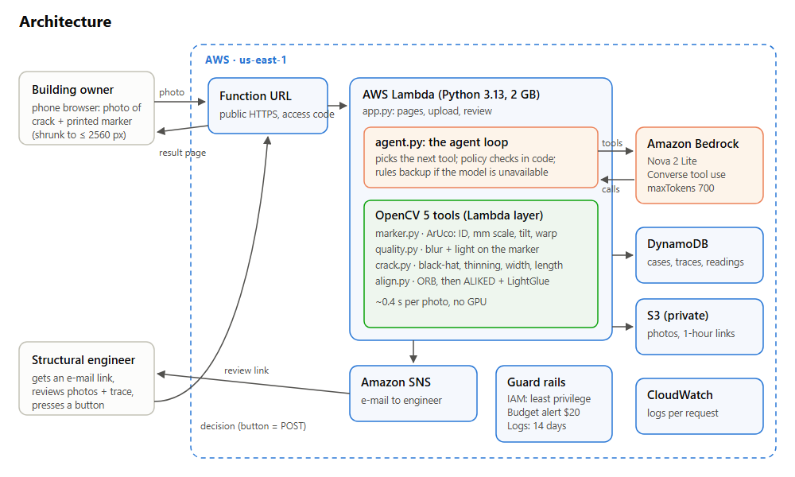
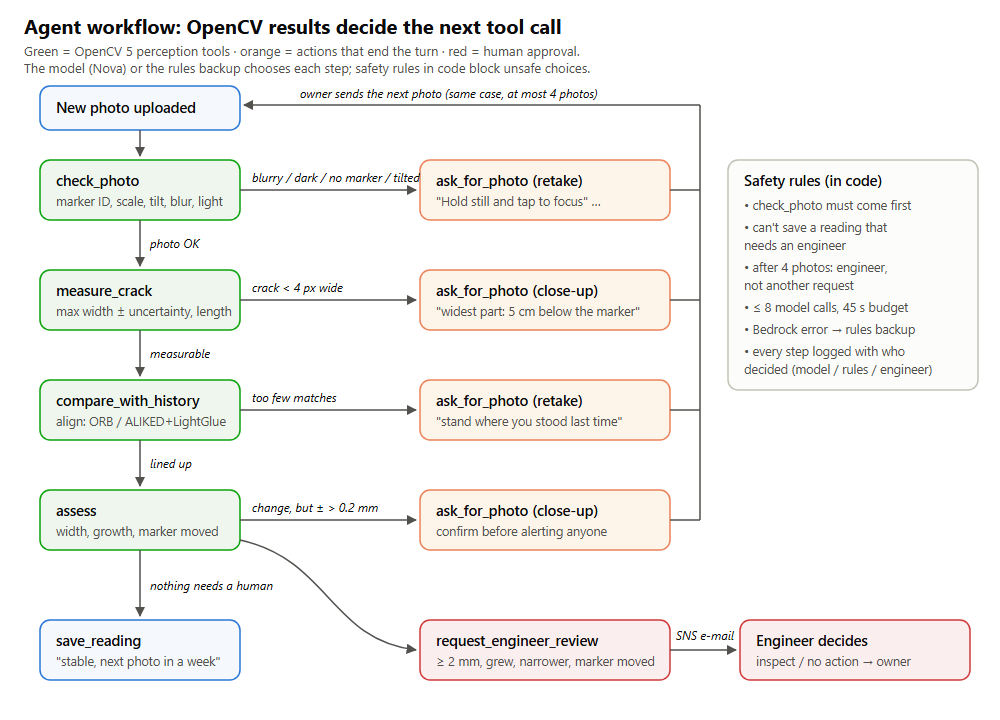

# Fissure Tracker: wall-crack growth monitor with an OpenCV 5 agent

**OpenCV AI Competition 2026 (powered by AWS) · Agentic Vision entry · Team: Asron, Anuj**

A building owner sticks a printed marker (a 60 mm black-and-white square) next to a wall crack and photographs
it once a week from a phone browser. **OpenCV 5** measures the crack in millimetres and lines the photo up with
last week's. An **AI agent** (Amazon Nova on Amazon Bedrock) calls those OpenCV functions as tools and decides
what happens next:
- ask for a better photo, with a specific fix
- ask for a close-up of the widest point
- save the reading as stable
- ask a structural engineer to approve the next step (e-mail through Amazon SNS)

Every decision is logged and shown on the case page.



## Why

Cracks in walls are common. Most are harmless, but a crack that **keeps growing** can signal settlement or
structural movement. The standard advice is to monitor it: measure the width every few weeks and get an
engineer if it widens. In practice nobody does this consistently, and phone photos of a crack say nothing
about millimetres. This project turns a phone photo into a measured, comparable, time-stamped reading, and
only bothers an engineer when the numbers say so.

## What the agent does with what it sees

| OpenCV result | Next step the agent takes |
|---|---|
| Blurry, dark, glare, no marker, strong tilt | `ask_for_photo(retake)` with the specific fix |
| Crack narrower than 4 pixels (too coarse to measure) | `ask_for_photo(closeup)` + where the widest point is |
| Photo shows a different part of the wall | `ask_for_photo(retake)`: "stand where you stood last time" |
| Width changed, but the measurement is coarse (± > 0.2 mm) | `ask_for_photo(closeup)` to confirm first |
| ≥ 2 mm, grew beyond the uncertainty, narrower, or marker moved | `request_engineer_review` → SNS e-mail → engineer presses a button |
| Nothing needs a human | `save_reading`: "stable, next photo in a week" |



**Safety rules in code** (the model can't override them): `check_photo` comes first. A reading that needs
an engineer can't be saved as normal. After 4 photos in one case, the case goes to the engineer instead of
another request. The model gets at most 8 tool calls and 45 s. If Bedrock fails, a **rules backup** calls the
same tools in a fixed order. Every step records who decided: the model, the rules, or the engineer.
See [docs/trace_example.md](docs/trace_example.md).

## OpenCV 5 in this project

| File | OpenCV 5 functions |
|---|---|
| `marker.py` | `aruco.ArucoDetector` (DICT_4X4_50, sub-pixel corners) → marker ID = crack ID; marker size → mm scale; homography → tilt; `warpPerspective` → straight-on view in exact mm |
| `quality.py` | blur measured on the marker's edges (`Sobel`), light from its black and white levels |
| `crack.py` | `morphologyEx` black-hat for thin dark lines, noise-based threshold, `connectedComponentsWithStats` (long and thin only), wide dark areas (stains, shadows) blanked out, Zhang-Suen thinning, Dijkstra main path → length; local area / length → width; widest point; ±1 px uncertainty; BRE Digest 251 damage category |
| `align.py` | CLAHE, `ORB` features on the wall (marker masked), `BFMatcher` + ratio test; when ORB finds too few matches, OpenCV 5's **`ALIKED` + `LightGlueMatcher`** (ONNX networks in OpenCV's DNN engine); `estimateAffinePartial2D` (RANSAC) in mm → shift/rotation; detects a moved marker |

The ALIKED + LightGlue models (52 MB) are downloaded once with `python tools/get_models.py` (same files and
checksums as OpenCV's own tests). Without them the app uses ORB only. On real photos of a curled sheet, ORB
alone lined up 9 of 13 photo pairs; ORB with the networks as backup lined up 12 (`docs/evaluation.md` §4).

## Results (synthetic photos with a known answer; full tables in [docs/evaluation.md](docs/evaluation.md))

- **Printed test lines (1–3 mm):** mean error 0.04–0.05 mm, max 0.09 mm, from 220–400 mm and up to 25°.
- **Wiggly cracks:**
  - Typical width within 0.05 mm on average.
  - Max width reads +0.13 mm high on average, but very consistently: 0.02 mm standard deviation over 8 viewpoints. So week-to-week growth is still measured fairly.
- **Too-thin cracks are never guessed:** every crack under 4 px was flagged for a close-up.
- **Alignment:** −25° vs +15° and 250 vs 450 mm still line up (shift error < 0.3 mm). A marker moved by 4 mm or more is flagged, and the move is measured within 0.1 mm.
- **Speed:** 0.4–0.6 s per photo on a laptop CPU; the full agent turn takes ~0.7 s with the rules backup.

Real-photo results come from `tools/eval_lines.py` on photos of the printed test sheet (see below).

## Run it on a laptop (no AWS needed)

Windows PowerShell, Python 3.11+ (tested with 3.11.9 locally; Lambda runs 3.13):

```powershell
cd crack_monitor
python -m venv ..\venv
..\venv\Scripts\pip install -r requirements-dev.txt     # opencv-python-headless 5.0.0.93, numpy 2.4.6, pytest, boto3
..\venv\Scripts\python tools\get_models.py              # OpenCV 5 ALIKED + LightGlue models, 52 MB (optional)
..\venv\Scripts\python -m pytest                        # 84 tests, about 1 minute
..\venv\Scripts\python tools\make_demo.py               # demo history: 3 cracks over 5 weeks
..\venv\Scripts\python serve_local.py                   # http://localhost:8000/?code=demo
```

Open the printed address on a phone on the same Wi-Fi to use the camera. Engineer e-mails are printed in the
terminal locally.

Other tools:

```powershell
..\venv\Scripts\python crack.py photo.jpg               # measure one photo -> JSON + outputs\photo_crack.jpg
..\venv\Scripts\python align.py new.jpg old.jpg [orb|aliked_lightglue]   # line up two photos -> JSON + match image
..\venv\Scripts\python agent.py photo.jpg               # one agent turn, prints the trace
..\venv\Scripts\python tools\make_sheets.py             # regenerate the printable sheets
..\venv\Scripts\python tools\evaluate.py                # regenerate docs\evaluation.md (~3 minutes)
..\venv\Scripts\python tools\eval_lines.py samples\lines_*.jpg   # accuracy on real test-sheet photos
```

## Printing the marker

`sheets/markers.pdf` has markers 1–6 (one per crack); `sheets/test_lines.pdf` has marker 0 and lines of known
width for the accuracy test. Print on A4 at **100% / Actual size** and check that the 50 mm bar measures 50 mm.
No printer? `sheets/draw_guide.pdf` shows how to draw the markers on 1 cm graph paper.

## Deploy to AWS

Needs AWS credentials with permission to create the resources below, and Bedrock access to Amazon Nova 2 Lite in
us-east-1. Settings go in `crack_monitor/.env` (git-ignored):

```
ENGINEER_EMAIL=engineer@example.com
ALERT_EMAIL=you@example.com
BUCKET_NAME=an-existing-private-bucket
```

```powershell
..\venv\Scripts\python deploy\deploy.py --check     # read-only: access, Bedrock, what exists - creates nothing
..\venv\Scripts\python deploy\deploy.py             # deploy; prints the web address with its access code
..\venv\Scripts\python deploy\destroy.py            # delete everything afterwards (asks first)
```

**What it creates:**
- a Lambda layer with OpenCV 5 + numpy for Linux (76 MB zipped, 209 MB unzipped)
- one Lambda function (Python 3.13, 2 GB, 90 s) with a public Function URL
- a DynamoDB table (pay per request)
- an SNS topic, whose e-mail subscriber must confirm once
- an IAM role limited to its own photo folder, table, topic and model
- a log group with 14-day retention
- a $20/month budget alert that counts usage before credits

The script is safe to re-run after code changes, and the AWS account ID is never printed.

**Cost:** about 1–2 cents per photo, mostly the Bedrock calls; Lambda, DynamoDB, S3 and SNS stay within
the free tier at demo scale.

## Responsible use

- **Not an engineering assessment.** The app measures and reports; decisions about safety are left to a
  structural engineer, who must approve before the owner is told to act. The thresholds (2 mm, 0.2 mm) are
  project settings, not building codes. BRE Digest 251 categories are shown for orientation only.
- **Photos stay private:**
  - The S3 bucket is private, and pages use 1-hour links.
  - Uploads and the overview need an access code; case pages use unguessable IDs.
  - The engineer link works once and only by pressing a button. E-mail scanners that follow links can't approve.
- **Cost and abuse limits:** 300 uploads a day, ≤ 8 model calls and 45 s per photo, 5.5 MB per upload, and a
  budget alert.
- **No personal data is needed:** no accounts, names or locations.
- **Data:** all evaluation images are synthetic, rendered by `tests/synthetic.py`. No third-party datasets are used.

## Limitations

- Max width reads ~0.1 mm high. Cracks under ~0.3 mm need a close-up.
- A drawn line or a straight cable shadow looks like a crack. A crack inside a dark stain is measured only outside the stain.
- Tilt correction assumes a typical phone lens. Very wide or zoomed lenses add error.
- Alignment needs some wall texture. On plain paint it is skipped (the owner isn't blamed).
- Real crack growth takes weeks, so the demo simulates growth.

## Project layout

```
crack_monitor/
  marker.py quality.py crack.py align.py   OpenCV 5 perception
  agent.py                                 the agent: tools, safety rules, Bedrock loop, rules backup
  app.py serve_local.py lambda_function.py web app (laptop + AWS Lambda)
  store.py                                 local files or DynamoDB + S3
  deploy/                                  deploy.py, destroy.py
  tools/                                   printable sheets, evaluation, demo data
  sheets/                                  printable PDFs/SVGs
  tests/                                   pytest suite + synthetic photo generator
  docs/                                    report, evaluation, diagrams, trace example
```

Third-party: OpenCV (Apache 2.0), numpy (BSD), boto3 (Apache 2.0).
